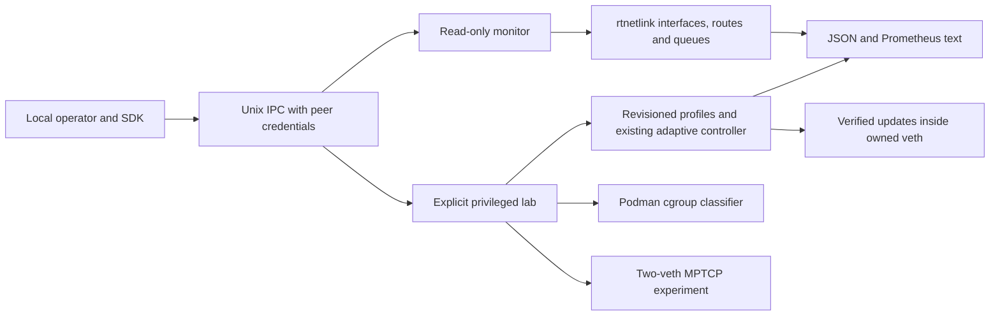
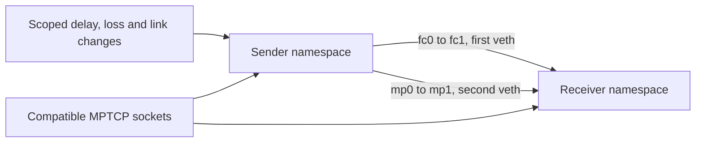

# FLOWCORE architecture

Current runtime ownership is documented in [NATIVE_CORE.md](NATIVE_CORE.md). The following MVP design describes the original legacy controller and is retained as historical architecture. The current Python daemon, typed helper, SDK, native kernels and optional BPF collectors extend that design. See [FEATURE_MATRIX.md](FEATURE_MATRIX.md) for independently tested scope.

## Historical MVP

## Objective and scope

Reduce critical TCP request completion P99 during local egress contention while
preserving background bandwidth. The MVP uses explicitly configured TCP service
ports and application measurements. A port identifies an operator-designated
service. It does not authenticate an application or reveal encrypted deadlines.

The first deployment is a disposable two-network-namespace lab on Fedora 45
ARM64. All files, builds and evidence live in this directory. Namespace lifetimes
are held by processes, so no named namespace files in /run/netns are needed.
The existing Linux TCP stack and traffic-control schedulers provide the data
plane. No custom kernel module or eBPF component is required.

## Vertical slice

* C++23 controller reads validated one-second application feedback from stdin.
* Pure policy logic applies hysteresis to application P99 versus an explicit SLO.
* A privileged actuator calls a fixed absolute tc executable with an argv array,
  checks its exit status and changes only pre-created HTB classes.
* A read-only rtnetlink RTM_GETLINK query records interface byte/drop counters.
* A Python namespace harness creates veth, queues and controlled TCP workloads,
  collects request samples, receiver throughput and tc counters, then cleans up.

The controller starts in balanced mode. Two consecutive valid windows above the
SLO enter protected mode. Four consecutive windows below 70% of the SLO return
to balanced mode. Sparse windows hold policy. Missing telemetry triggers balanced
mode after three seconds. This prevents stale priority persisting indefinitely.
The benchmark owns topology and classification. The controller owns only class
rates and priorities within that topology. Process exit also restores balanced
mode. The last kernel policy remains bounded if SIGKILL prevents cleanup.

Balanced mode reserves 20% of link capacity for critical traffic with equal HTB
priority to background. Protected mode reserves 40% with critical borrowing
priority. Both classes can borrow to line rate. Background always has at least
60% configured rate. fq_codel provides per-flow scheduling inside each class.
These rates are scheduling commitments at a shaped virtual link. Application
goodput and per-flow fairness must be measured separately.

## Configuration and input

`config/lab.conf` is strict key=value text. Unknown and duplicate keys fail.
Fields are interface, absolute tc path, capacity_kbit, slo_ms, minimum_samples,
balanced_percent and protected_percent. Configuration bounds prevent zero or
negative capacities, invalid interface names, and background reservation below
50%. Root must review configuration and the executable before use.

Feedback is a line containing `p99_ms sample_count`. P99 is a nearest-rank
percentile computed from actual completed request measurements. The harness
includes failed requests in its report and feeds a breach signal when a window
contains failures. The control signal is privileged and trusted in this lab.
A deployed collector will require peer credential checks and permission-scoped
service enrollment. Application-reported deadlines are an explicit future API.

## Privilege and threat boundaries

The harness needs root for network namespace creation, moving links and tc. Test
workloads drop to the invoking user after entering their namespace. Namespaces
have loopback plus their veth endpoint only, with no default route. No forwarding
or connectivity to the host network is configured. The root control path accepts
bounded numeric feedback and validated configuration, never shell commands.

This is a manually invoked lab tool, not an installed privileged daemon. Running
a root harness from a user-writable tree grants that tree administrator trust.
A production package must have root-owned code/config, a minimal CAP_NET_ADMIN
helper confined to a chosen namespace/interface, authenticated IPC and an
allowlist of operations. Port matching alone is unsuitable for mutually
untrusted tenants. cgroup v2 is available but is not used for classification in
this slice. Assess cgroup/socket attribution only when real deployment needs it.

## Observability

Request sample CSV includes scheduled start, completion, latency and outcome.
The summary includes P50/P95/P99/max, offered/completed/failed request counts,
receiver background bytes per flow, aggregate goodput and Jain fairness index.
Controller JSONL records feedback, state, transition and link TX bytes/drops.
`tc -s -j` snapshots preserve queue backlog, drops, overlimits and class counters.
TCP RTT is optional diagnostic context and is not application latency.

## Failure semantics and limits

Configuration/attach failures fail the experiment. Runtime tc failure stops the
controller and is visible as a failed trial. A two-class update cannot be atomic
through tc: decreases precede increases, and failed updates attempt balanced
rollback. Report both the original failure and any rollback failure. There is no
automatic recovery of an unrelated host qdisc; experiments create fresh namespaces.

The first workload has fixed request size and no server compute. It isolates
local egress scheduling. VM scheduling, CPU use, offloads, TCP buffering and
small-sample tail variance can dominate. Results from this machine establish
only this workload's behavior. Winning against FIFO is insufficient evidence
of value beyond tuned static policy or CAKE.

## Staged roadmap and gates

1. Build and unit-test configuration/policy. Probe actual namespace, qdisc,
   classification and rtnetlink operations on the target kernel.
2. Run all baseline modes and adaptive controller with raw evidence. Reject
   trials with workload errors, missing counters or process failures.
3. Compare at least three independent held-out repetitions after a separate
   static-policy tuning sweep. Require at least 1,000 completed requests per
   run for exploratory P99, and 10,000+ per run for a serious tail comparison.
4. Add changing critical demand, multiple service sizes and asymmetric paths.
   Continue only if adaptive policy improves tails versus the selected static
   policy while maintaining declared bandwidth/fairness constraints.
5. If a concrete attribution/queue observation gap blocks a demonstrated use
   case, evaluate existing kernel telemetry first, then optional libbpf.
6. Harden privilege separation, configuration lifecycle and host deployment
   only after reproducible evidence supports the control policy.

## Managed laboratory service

The earlier sections describe the standalone adaptive controller and benchmark.
The management path adds flowcored, a single-threaded Python service that reuses
the namespace harness and the compiled C++23 RTM_GETLINK reader. The C++23
adaptive controller still runs through `flowcore --config` in the benchmark.
The daemon applies named static policies and owns their lifecycle.

The version 1 JSON configuration in config/service.json selects the owned
sender interface fc0 and defines named policies, class ports, guaranteed and
maximum shares, priorities, the default lab profile and telemetry/log settings.
The service validates the entire file before opening its socket. An identical
apply is a no-op while the two holders are alive. Changed policy or profile is
staged in a fresh namespace pair. The service switches only after the candidate
passes installation and topology checks. A failed candidate is destroyed and
the previous lab is retained. A successful replacement interrupts existing lab
connections and changes namespace PIDs. Runtime changes are kept in memory.

The backend uses tc JSON for qdisc/class/filter inspection and argv-based tc for
writes. HTB with fq_codel uses four fixed named classes and configurable TCP
destination ports. Unmatched packets go to standard. Flower rules cover IPv4
and IPv6. CAKE is an alternate fair-queue policy and does not expose the four
HTB classes. The capability status records successful kernel installation.
When installation fails the API returns the tc error and preserves the old lab.
Netem on receiver egress applies the configured delay, jitter, loss and reorder
parameters to the reverse direction.

Application cooperation means targeting an enrolled destination port. This
works for TCP services even with encrypted payloads. The administrative
configuration assigns each port and guarantee. A port cannot prove process
identity, distinguish requests multiplexed over one encrypted connection, or
infer deadlines. Socket marks or cgroup identity would need an explicit trusted
producer and classifier. The daemon does not use eBPF.

Native rtnetlink dumps provide interface state, MTU, IPv4/IPv6 addresses and
basic routes. Multicast subscriptions observe link, address and route events in
the host and both lab namespaces. Status exposes a bounded recent event buffer.
Host link speed is reported from sysfs when available. Lab link speed is left
unknown because the inherited sysfs mount represents the host. HTB and qdisc
counters come from tc, and sender TX counters use the existing C++ reader.

### Ownership, privileges and recovery

The service is the sole writer of its disposable veth topology. It does not
attach to existing host interfaces. Root is required to provision the lab.
The CLI uses local IPC and workload integration tests run TCP generators as the
invoking user. The daemon runs a single bounded JSON request per connection on a
private Unix socket and checks SO_PEERCRED against its effective UID. With sudo
that means root clients only. The process also holds an exclusive runtime lock.
A root launch requires a trusted project tree and configuration.

Namespace holders receive a parent-death signal. A graceful exit closes the
watchers and holders and removes the socket. On restart the service removes its
stale runtime socket and scratch directories after acquiring the lock. If a
holder exits unexpectedly, health reports the failure, closes the lab, and
allows an explicit lab up. External processes started manually inside the lab
should be stopped before lab down. They can otherwise hold their namespace alive.

The daemon processes commands serially. Slow kernel tooling can delay status
queries until the command timeout. Socket input, response size and recent events
are bounded. Host deployment needs a dedicated, restricted privileged helper,
root-owned installation, authenticated application attribution, and service
supervision. A versioned adaptive feedback API and coordinated adaptive service
ownership remain future work. Existing benchmark measurements are unchanged in
meaning and describe the standalone controller, not the new management service.

## Deep observability

The daemon now owns an observer per lab generation. INET_DIAG polling, optional
scoped CO-RE tracing and authenticated application reports feed independent
bounded metrics. Queue statistics come from the existing tc backend and the
extended C++23 RTM_GETLINK reader. Observer errors degrade telemetry health and
do not invalidate the installed traffic policy. See OBSERVABILITY.md for metric
semantics, limits, API, exports and test commands.

## Managed adaptive control

The daemon connects application intent leases and observer windows to a
bounded HTB allocation controller. Static, threshold and SLO strategies share
one actuator. Active adjustments remain confined to existing fc0 classes,
with a protected background floor and verified kernel readback. Failed probes
roll back and external drift stops further writes. The standalone C++23
benchmark controller remains available for its original experiments. The
C++23 SDK provides explicit per-request measurement through authenticated
Unix IPC. See ADAPTIVE.md and ADAPTIVE_RESULTS.md.

## Deployment and experimental paths

The production package ships only the no-capability monitor unit. Kernel
mutations remain explicitly owned laboratory operations. See PLATFORM.md,
SECURITY.md and RELEASE.md.
