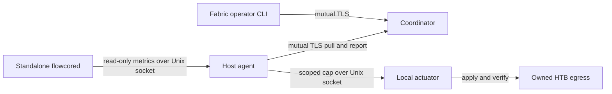

# FLOWCORE Fabric

Fabric adds an optional coordinator and a sidecar agent. The standalone daemon keeps its local socket, SDK and policies. An agent can run without an actuator and report inventory and telemetry. The experimental actuator is a separate local process for an explicitly prepared research interface.



## Policy and topology

A host has a pinned certificate identity, operator-enrolled environment and groups, and a named service-to-class inventory. The agent reports its Linux boot identity, selected interfaces, application measurements and local controller state. Enrollment supplies the interface-to-resource mapping and an explicitly identified path. A resource has one configured capacity and a list of path labels. Those labels describe a known bottleneck, such as a controlled router egress. They provide no Internet path discovery.

A rule selector can combine hosts, service names, groups, environment and class. Fields are combined with AND. A list matches any of its members. The highest precedence matching rule wins for each enrolled service, with lexical rule ID breaking ties. The allocator sums desired rates, uses the strongest matching service weight, and can double a weight when a recent window with at least twenty successful samples exceeds its application P99 target. It takes the maximum of declared demand and observed egress rate, then clamps that value to the local floor and ceiling. A deterministic integral weighted max-min allocator distributes remaining capacity above protected floors. A lower observed rate may reflect shaping. Explicit demand is needed when the observed rate cannot represent offered load.

Local authorization takes precedence. The cluster selects a single aggregate egress cap per participating host. It cannot change an operator's local floor, ceiling, interface ownership, classifier, scheduler tree or standalone daemon policies. Service priorities influence the host cap. They do not install per-service qdiscs, reserve capacity on a remote link, or guarantee application latency. The experimental actuator refuses an already configured interface. Use a separate research egress for Fabric so the standalone controller retains its existing ownership.

## Reconciliation

1. The coordinator persists an epoch, generation, current caps and any pending increases. Only explicit operator reconciliation advances a generation.
2. An agent pulls desired state in its heartbeat response. It checks local scope and persists the accepted generation before writing.
3. The local actuator reads the installed HTB class, changes its rate and ceil together, reads them back and returns an acknowledgement. The agent reports that acknowledgement separately from the earlier desired state.
4. When an allocation contains both decreases and increases, the coordinator first commits the component-wise minimum of current and target. It commits increases only after every participating agent reports a fresh kernel-verified acknowledgement for that generation. A missing acknowledgement stalls rollout.
5. The actuator renews a short local lease after a valid policy refresh. On expiry, it reduces its cap to the local floor. This floor can never exceed a committed cap.

The coordinator's acknowledgement view is eventually consistent. Generation checks prevent stale messages from replacing newer caps. Independent agents can be in different generations between phases. The budget argument assumes the configured choke point, exclusive local queue ownership, a single coordinator state lineage, and honest local readback. HTB rates have short packet bursts. External traffic, forwarding changes, unmanaged NICs, and concurrent root writers are outside that budget.

## Deploy on controlled Linux hosts

Use a private state directory owned by each unprivileged process and a locally administered PKI. The default Linux daemon remains independently useful without Fabric. The source-tree commands below are also available as installed scripts under the FLOWCORE data directory.

```sh
python3 -B scripts/fabric_coordinator.py coordinator.json --state /var/lib/flowcore-fabric/coordinator
python3 -B scripts/fabric_agent.py agent.json --state /var/lib/flowcore-fabric/agent
flowcore fabric status --config operator.json
flowcore fabric agents --config operator.json
flowcore fabric services --config operator.json
flowcore fabric policies --config operator.json
flowcore fabric diagnostics --config operator.json
flowcore fabric reconcile --config operator.json
flowcore fabric reconcile --config operator.json --apply
```

An observe-only agent omits `egress`. Its required keys are `cluster`, `host`, `coordinator`, `tls`, `interfaces` and `services`. It can specify an optional `daemon_socket` and poll interval `poll_ms`. Use the daemon's permitted UID to read that socket. The endpoint object contains `host`, `port`, and the TLS DNS `server_name`. TLS configuration contains absolute `ca`, `cert` and `key` paths. An operator config contains only `coordinator` and `tls` and uses a separate certificate.

The coordinator config contains `cluster`, `listen` (host and port), `tls`, `admins` (pins), `agents` (host-keyed enrollments), `resources`, and `intents`. Each enrollment has `pins`, `environment`, `groups`, `services` (name to class), and optional `egress` with `resource`, `interface`, `floor_kbit` and `max_kbit`. Each resource has `capacity_kbit` and `path`. Each intent has `id`, `match`, `precedence`, `weight`, `desired_kbit` and `target_p99_us`. Rates use decimal kbit/s.

To enable cap enforcement, prepare a disposable network namespace and mark its dedicated Ethernet interface with the alias `flowcore-lab:<owner>`. Run `fabric_actuator.py actuator.json --socket /path/to/root-owned-dir/node.sock` as root inside that namespace. The root-owned configuration specifies `cluster`, `host`, `resource`, `interface`, `owner`, `floor_kbit`, `max_kbit`, `agent_uid` and `agent_gid`. The agent's egress configuration repeats the resource, interface, floor, ceiling and adds the actuator `socket` path. The coordinator and agent reject root execution. The reproducible fixture builds all configurations and ephemeral identities automatically. See [FABRIC_BENCHMARKS.md](FABRIC_BENCHMARKS.md).
