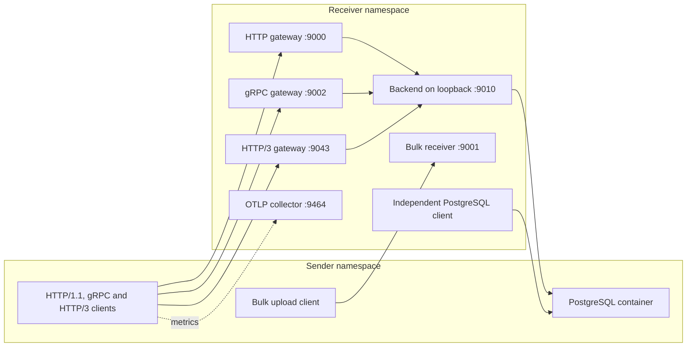

# Service stack and reproduction



The veth sender egress is the bottleneck in shaped runs. Reverse netem
runs on receiver egress. Gateway to backend calls stay on receiver
loopback. Database queries cross the veth to PostgreSQL on the sender,
so database replies and sender uploads share the shaped direction.
PostgreSQL uses a disposable Podman container with its network namespace
explicitly set to the sender's pinned namespace descriptor. There is no host port publication. The
test uses trust authentication only inside the disposable namespace.
The runner mounts a copy of the schema and removes the container on exit.

Gateway to backend and backend to PostgreSQL use bounded persistent
connection pools. Each HTTP client worker owns one persistent connection.
gRPC uses concurrent unary calls on one HTTP/2 channel, propagates the
RPC budget to its backend request and can issue deterministic client
cancellations. An upstream operation already in progress can continue
until its own timeout. [gRPC deadline behavior](https://grpc.io/docs/guides/deadlines/) HTTP/3 shares one connection across concurrent
streams and sends STOP_SENDING when an app deadline expires. A temporary
trusted certificate is generated per run. TLS verification is enabled. [aioquic HTTP/3 API](https://aioquic.readthedocs.io/en/latest/h3.html)

Database timing includes independently measured query completion, server
executor aggregates from pg_stat_statements, gateway and backend pool
waits and TCP smoothed RTT samples from the independent libpq clients.
The backend's query round trip includes protocol, kernel, application and
database time. PostgreSQL executor time and TCP SRTT are separate measures.
The lab does not compute network wait by subtracting unrelated aggregates.
[PostgreSQL executor statistics](https://www.postgresql.org/docs/16/pgstatstatements.html)
Component CPU and RSS snapshots include the daemon, gateways, backend,
collector and bulk process. PostgreSQL cgroup CPU and memory include its
workers when cgroup counters are available. CPU windows include client
startup and drain, and process RSS is a snapshot.

## Build and dependencies

Use the recorded Fedora RPM versions in
[config/real-app-v2-fedora45.txt](config/real-app-v2-fedora45.txt) or a
compatible environment. The test VM used Fedora 45 ARM64, Python 3.15
and Linux 7.2.11-300.fc45.aarch64. Use the pinned gRPC dependencies
in [requirements.txt](examples/real_apps/requirements.txt) and a
compatible psycopg build. PostgreSQL fixtures use a bounded 128 MiB
tmpfs for per-trial database state. This setup does not measure
production database disk I/O. The QUIC worker uses a separate venv with
[config/quic-requirements.txt](config/quic-requirements.txt).

```sh
cmake -S . -B build -DFLOWCORE_BPF=OFF -DCMAKE_BUILD_TYPE=Release
cmake --build build -j4
python3 -m venv build/quic-venv
build/quic-venv/bin/pip install -r config/quic-requirements.txt
sudo podman pull docker.io/library/postgres@sha256:9f5be6795d4e9dfc0dca4c8a46eb858a9ddef631fc6b57953960f578d3fb1f9b
```

The experiment itself uses `--pull=never` and requires a local image
by digest. It uses the project's `tc` selected by `scripts/paths.py`.
The VM used iproute2 7.0.0. If the checkout has no bundled binary, pass
`sudo env FLOWCORE_TC=/usr/sbin/tc` before the Python command.
See [the results](APPLICATION_PERFORMANCE_RESULTS.md) for exact workload
commands. All options are available through
`python3 -B scripts/real_app_lab.py --help`. Omitting `--stack` retains
the original standalone lab. Omitting `--grpc` or `--http3-python` skips
the corresponding optional protocol.

To try the same HTTP gateway without root, a daemon or a database, run
these three commands in separate terminals from the source checkout.

```sh
python3 -B examples/real_apps/http_service.py --bind 127.0.0.1 --only-role critical --critical-port 9010
python3 -B examples/real_apps/http_service.py --bind 127.0.0.1 --only-role critical --upstream-port 9010
python3 -B examples/real_apps/http_benchmark.py --host 127.0.0.1 --no-flowcore --background-bytes 0 --output results/local-http.json
```

Each experiment stores mode order, seed, workload options, platform,
dependency versions, raw attempts, SDK and OTLP status, configuration and
actual kernel readback. Dynamic runs retain scheduled, started and
kernel-confirmed phase times. Recovery is elapsed time from verified
restoration to the first offered request after restoration that returns
within its deadline. An absent value means no qualifying request was
observed before the end of the trial. It does not imply that the link
never recovered.
