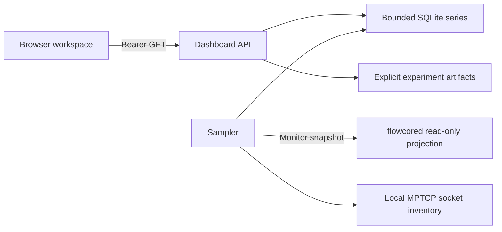

# Dashboard UI architecture

The dashboard consists of a static HTML, CSS and JavaScript workspace, a loopback HTTP server, and a single background sampler. Browser access requires a bearer token. The client builds text and SVG nodes directly and uses no third-party browser scripts, cookies, local storage or external charts. A strict content security policy restricts resources to the same origin and disables framing.

One daemon event-loop operation projects current telemetry, controller state, policy history and incident inventory. The sampler polls independently of HTTP clients. It keeps a last-good snapshot in memory, explicitly marks a stale source, and records a gap when sampling fails. Historical queries select stored points by identity and time. Lines break across known gaps and changes in scope or rolling window. The browser requests new snapshots without overlapping its refresh loop. History samples are bounded by age, row count and SQLite page count.

The delegated abstract Unix socket admits one configured nonroot UID and validates peer credentials. It recognizes only monitor snapshots and retained incident reads and accepts no passed descriptors. The dashboard also verifies the UID of its daemon peer. The existing control socket keeps its separate permissions and authorization. The source-tree same-UID option is intended for a dedicated monitor-only daemon.

## Views and provenance

- **Overview** combines directional throughput, queue backlog and drops, capacity and headroom provenance, critical P99, background class traffic and current controller mode.
- **Service SLOs** plots rolling application percentiles, outcomes, sample counts and reports per second. Shading means observed P99 exceeded its configured target. Low sample counts remain visible.
- **Controller** keeps proposed, applied and verified fields separate and shows recorded shadow, hold, rejection and rollback decisions with paging.
- **Bottlenecks** shows directional evidence, attribution scope, uncertainty and read-only suggestions. A suspected remote path is a diagnostic hypothesis.
- **Incidents** filters a retained event sequence by kind and displays relative time, packet or application evidence, diagnostic candidates and missing evidence. Replay is an interpretation of stored events.
- **Multipath** separates local socket inventory from measured laboratory path quality, subflow observations, transitions and recovery. The local kernel inventory cannot report arbitrary per-socket subflow telemetry. Archived TCP fallback remains explicitly labeled.
- **Experiments** keeps comparisons within a configured dataset and shows one P99 per run. It preserves failure, configuration, goodput, fairness, CPU and controller details where the source supplies them. Simulated outcomes are excluded from measured plots.

The v1 API is a monitoring projection. It does not provide kernel control, arbitrary daemon RPC forwarding, cross-host clock correlation or a cluster-wide SLO percentile.
